<div align="center">

# ⚖️ EU AI Compliance Auditor

**Local, privacy-by-design compliance audit of AI projects against the EU AI Act and the GDPR**


-black)


</div>

**EU AI Compliance Auditor** is a fully local multi-agent RAG application that audits an AI project
against the EU AI Act and the GDPR. You share the project's deck. An AI assistant then interviews you
about what the document leaves out. Finally, LangGraph agents grounded in the official legal texts
write a report: the risk category, the applicable obligations with their exact deadlines, and a
prioritised action plan in which every point cites its source. LLMs, embeddings and the vector
database all run on your machine.

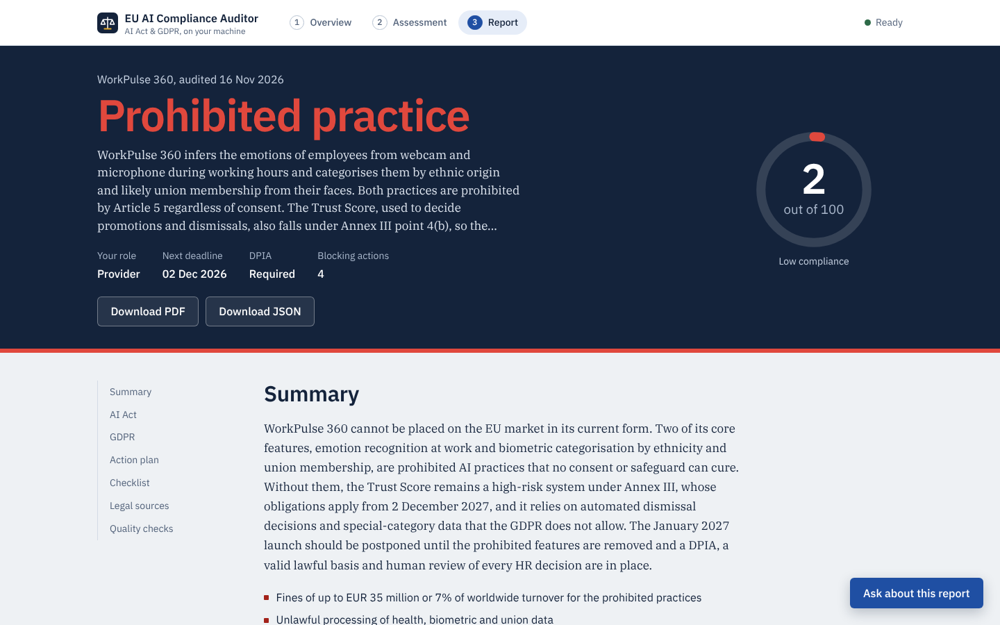

> ⚠️ Decision-support tool. It does not constitute legal advice.

---

## Contents

- [A walk through an assessment](#a-walk-through-an-assessment)
- [Architecture](#architecture)
- [Quick start (Docker)](#quick-start-docker)
- [Local installation (uv)](#local-installation-uv)
- [Try it without Ollama](#try-it-without-ollama)
- [Configuration](#configuration)
- [HTTP API](#http-api)
- [Code quality](#code-quality)
- [Testing & evaluation](#testing--evaluation)
- [Repository layout](#repository-layout)
- [Known limitations](#known-limitations)

## A walk through an assessment

The screenshots below follow the fictitious project `examples/workpulse360_high_risk_project.pdf`:
a workforce-analytics product that monitors employees' emotions and scores their loyalty.

### 1. Overview: where the regulation stands today

The home page shows which obligations come into application next, the full regulatory calendar
(AI Act dates as amended by Regulation (EU) 2026/1744, plus the GDPR), and the health of the local
services. From here you can rebuild the legal index.

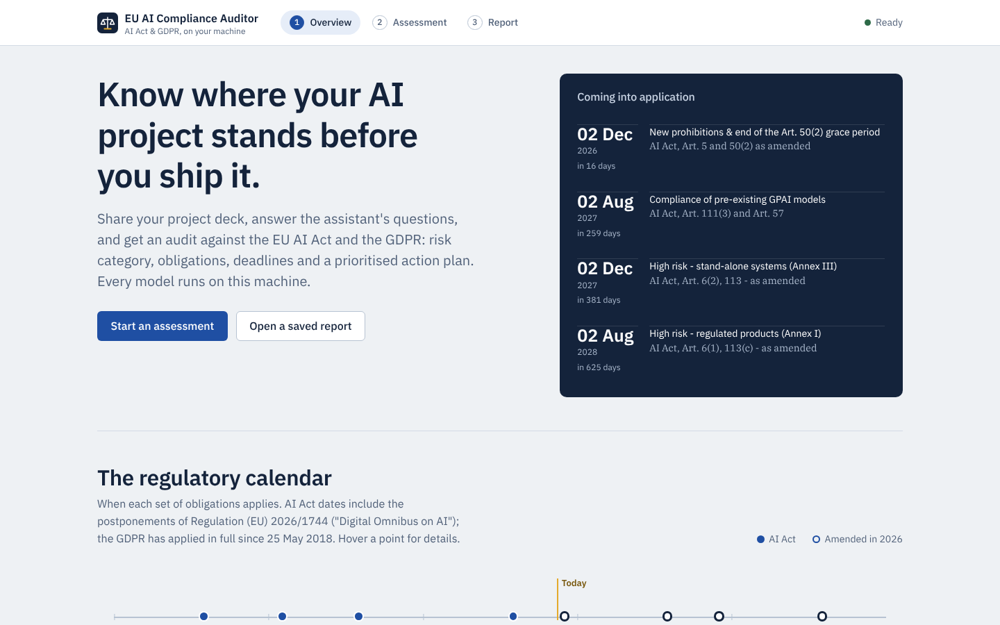

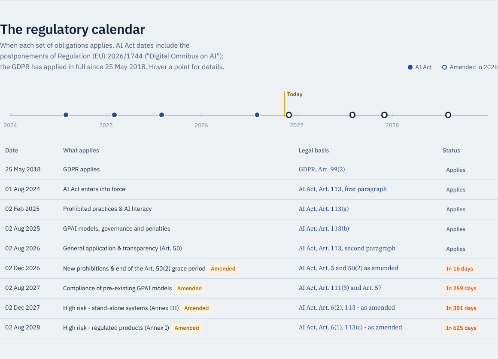

### 2. Assessment: share the project, then answer the assistant

Upload the deck (`.pdf` or `.pptx`), add any context it leaves out, or simply describe the
project in your own words.

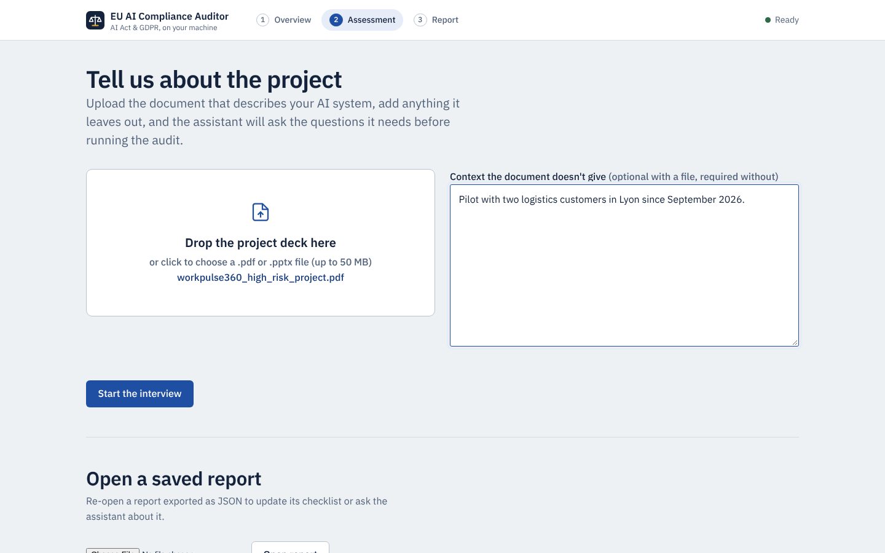

The assistant reads the document and asks only the questions that change the legal assessment:
who takes decisions, which data, which model, which safeguards. Each question says *why* it
matters. Questions are yes/no, multiple-choice or free text.

On the left, the **project file** shows what the assistant knows. It is updated after every round
(at most `MAX_INTERVIEW_ROUNDS` rounds). You can stop at any time and write the report.

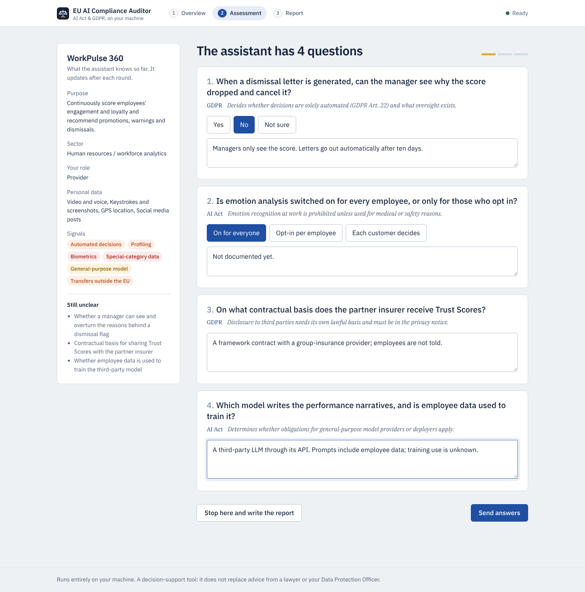

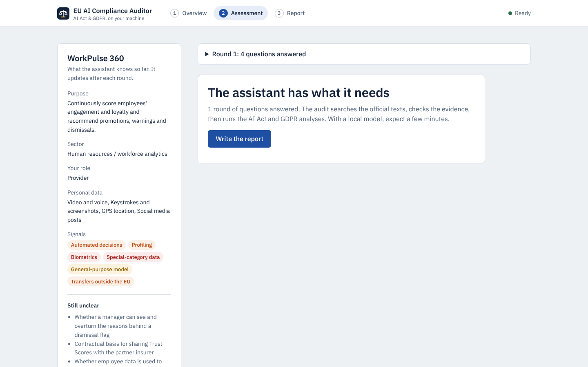

### 3. Report: verdict, obligations, plan and checklist

While the audit runs, the page streams each step of the agent graph live, over server-sent events.

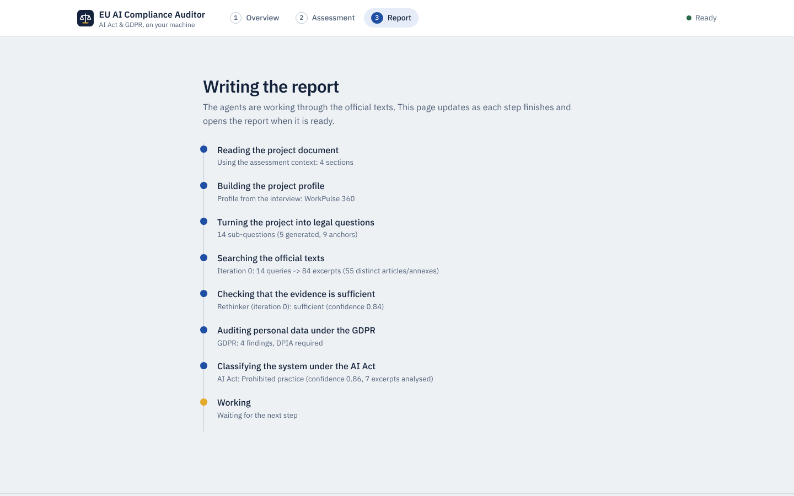

The report opens with the verdict: risk category, rationale, next deadline and score. Below it:

- **AI Act:** classification and applicable obligations, each with its status and the gap to close.
- **Deadlines:** the dates that apply to this project, computed deterministically rather than by
  the model.
- **GDPR:** assessment of the lawful basis, minimisation, DPIA and data subject rights, with
  detailed findings.

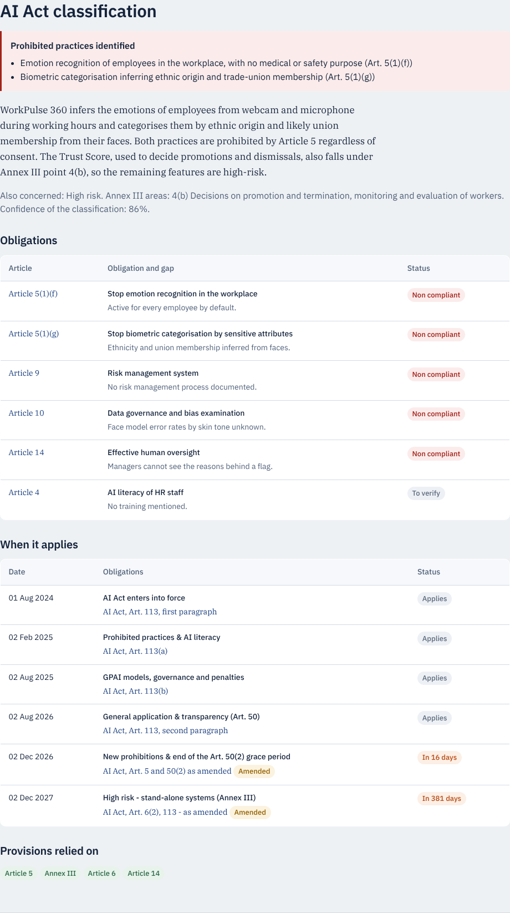

The action plan is prioritised from P0 (blocking) to P3, and each action carries its legal basis
and a due date. The interactive checklist merges the structural obligations of the risk category
with the recommendations. It is saved as you tick items, and its state is carried into the PDF
and JSON exports.

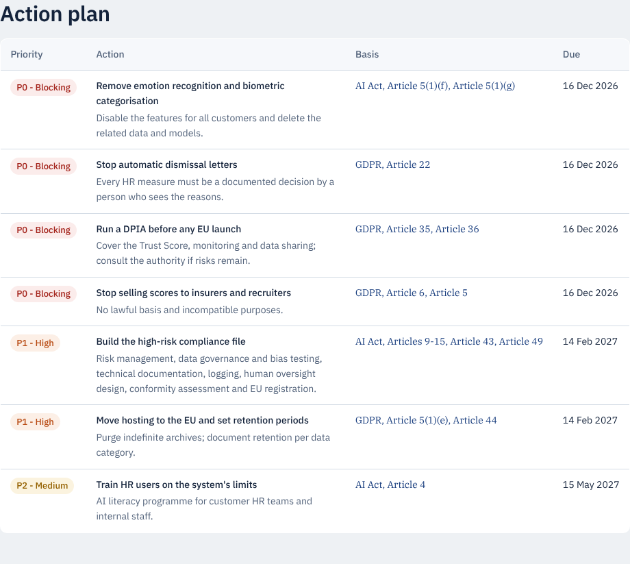

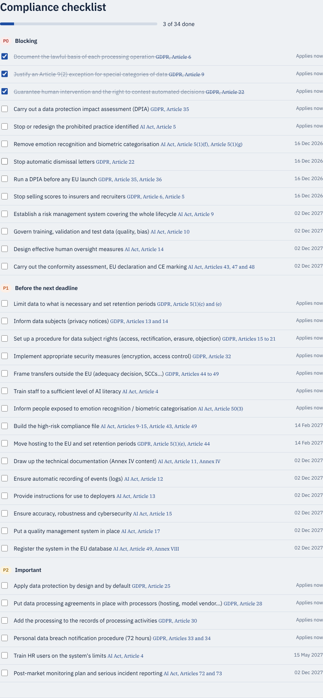

**Ask about this report** opens an assistant that answers from the report and the official texts.
It lists its sources and flags any article it cites that does not exist in the corpus.

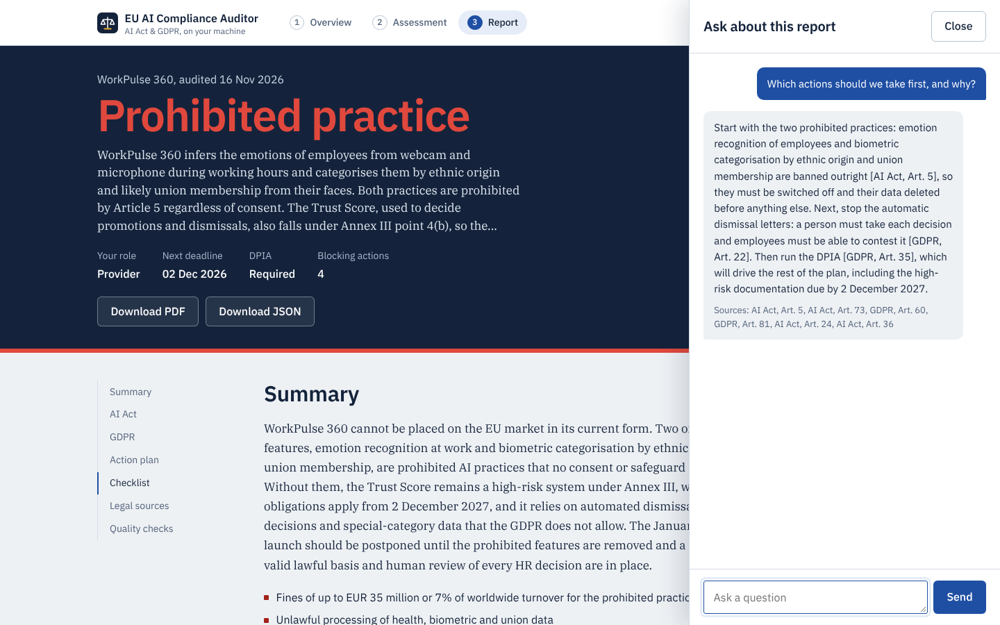

> The screenshots are produced by `scripts/capture_screenshots.py` with the *scripted* demo model
> (`scripts/demo_services.py`), so they can be regenerated identically anywhere. Everything else
> in them is the real application: parsing, legal corpus, retrieval, citation checks, deadlines,
> score, checklist and export. To capture your own from real model output, run the application
> and then `python scripts/capture_screenshots.py --url http://127.0.0.1:8000`.

## Architecture

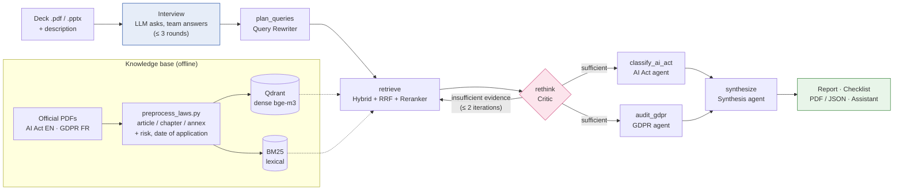

| Stage | Role | Guardrail |
|---|---|---|
| **Legal preprocessing** | Splits the texts by article and annex with a state machine that only accepts strictly sequential numbering | Integrity check: 113 articles + 13 annexes (AI Act), 99 articles (GDPR) |
| **Interview** | The LLM asks for the facts that change the legal qualification, and the project profile is refreshed after each round | Bounded number of rounds; deterministic fallback questions if the model fails |
| **Query Rewriter** | Generates targeted legal sub-questions, written in the language of each corpus | Deterministic anchor queries (Art. 5, Annex III, Art. 6, 22, 35, 50...) |
| **Hybrid retrieval** | Dense search (Qdrant, strict metadata filters) + BM25, fused with RRF, then reranked by FlashRank or `BAAI/bge-reranker-v2-m3` | Falls back to the RRF order when the reranker is unavailable |
| **Rethinker** | An LLM critic checks whether the evidence is sufficient; if not, it reformulates the queries | A regulation with no evidence forces another iteration; the loop is bounded |
| **Audit agents** | AI Act and GDPR analyses run **in parallel**, with Pydantic structured outputs | Every citation is validated against the corpus; confidence scales and enum spellings are normalised |
| **Synthesis** | Executive summary + plan prioritised from P0 to P3 | **Deadlines, score and checklist are computed by code**, never by the LLM |

**Web stack.**
- Server: FastAPI + Jinja2 templates and vanilla JavaScript, with no build step.
- Fonts: IBM Plex, bundled locally.
- No CDN or third-party request: a strict Content-Security-Policy (`default-src 'self'`) enforces it.

## Quick start (Docker)

Requirements: Docker ≥ 24 with Compose v2, and about 16 GB of RAM for `qwen2.5:14b`.

```bash
git clone https://github.com/antoinerougier/Conformity.git
cd Conformity
cp .env.example .env          # optional: choose the models

docker compose up -d --build  # NVIDIA GPU: add -f docker-compose.gpu.yml
docker compose logs -f ollama # first run: models are being pulled
```

Open **http://localhost:8000**.
- The `ollama` container pulls the models, and only becomes healthy once they are ready.
- The `app` container then indexes the legal corpus if needed and starts the web server.

## Local installation (uv)

```bash
uv venv --python 3.12
uv sync --all-groups
# Windows: .venv\Scripts\Activate.ps1   -   macOS/Linux: source .venv/bin/activate

ollama pull qwen2.5:14b && ollama pull bge-m3

# Qdrant: embedded (no Docker) ...
echo "QDRANT_URL=" >> .env && echo "QDRANT_PATH=./data/qdrant_local" >> .env
# ... or a server: docker run -d -p 6333:6333 qdrant/qdrant:v1.19.1

python -m src.rag.preprocess_laws --index --stats   # build the legal index once
uvicorn src.api.app:app --reload                    # http://127.0.0.1:8000
```

## Try it without Ollama

```bash
make demo        # = uvicorn scripts.demo_app:app --port 8000
```

This runs the real interface and pipeline, but with a scripted model whose answers describe the
WorkPulse 360 example. Use it to explore the interface; for real audits, use the commands above.

## Configuration

All settings come from environment variables or `.env` (see `.env.example`). They are validated
at startup by `pydantic-settings` (`src/core/config.py`).

| Variable | Default | Description |
|---|---|---|
| `OLLAMA_BASE_URL` | `http://localhost:11434` | Ollama server |
| `LLM_MODEL` / `JUDGE_MODEL` | `qwen2.5:14b` | Reasoning model / Ragas judge (`qwen2.5:7b` on machines with less than 16 GB) |
| `EMBEDDING_MODEL` | `bge-m3` | Multilingual embeddings (`nomic-embed-text` is supported too) |
| `LLM_NUM_CTX` | `16384` | Context window sent to Ollama |
| `QDRANT_URL` / `QDRANT_PATH` | `http://localhost:6333` / – | Server or embedded mode (leave `QDRANT_URL` empty for embedded) |
| `RERANKER_BACKEND` | `flashrank` | `flashrank` · `cross_encoder` · `none` |
| `MAX_INTERVIEW_ROUNDS` / `MAX_QUESTIONS_PER_ROUND` | `3` / `5` | Length of the interview |
| `MAX_RETHINK_ITERATIONS` | `2` | Maximum number of Rethinker loops |
| `SESSION_TTL_HOURS` | `24` | Assessments are kept in memory only, then forgotten |
| `RAGAS_MIN_*` | `0.70 / 0.60 / 0.60` | Quality gates |

## HTTP API

The pages use a JSON API that you can call directly. The OpenAPI schema is served at `/openapi.json`.

| Method & path | Purpose |
|---|---|
| `GET /api/health` | Status of Ollama, Qdrant and the reranker |
| `POST /api/sessions` | Start an assessment (multipart: `file` and/or `description`) |
| `POST /api/sessions/{id}/answers` | Answer the current round (`finish: true` closes the interview) |
| `POST /api/sessions/{id}/audit` | Run the audit in the background |
| `GET /api/sessions/{id}/events` | Live progress (server-sent events) |
| `GET /api/sessions/{id}/report` · `.pdf` · `.json` | The report |
| `PATCH /api/sessions/{id}/checklist/{item}` | Tick a checklist item |
| `POST /api/sessions/{id}/chat` | Streamed answer about the report (sources in `X-Sources`) |
| `POST /api/reports/import` | Re-open an exported JSON report |

## Code quality

- **Pydantic v2 everywhere.**
  - Domain models forbid unknown fields and use constrained types (identifiers, hashes, bounds)
    with cross-field validators.
  - Public functions that cross a layer boundary are decorated with `@validated`
    (`pydantic.validate_call`), and request bodies are Pydantic models.
- **Robust to local models.** Structured outputs are requested as a JSON schema, and a validation
  error is fed back to the model so it can correct itself. Common deviations are normalised
  before validation: confidence given as `85` or `"85%"`, or `"High-risk"` instead of `high_risk`.
- **Typed services.** Services are injected through `AppServices` and `AuditDependencies`.
  Interfaces are `Protocol`s, which keeps everything testable with fakes.
- **Explicit error model.** A domain exception hierarchy is mapped to HTTP errors (JSON for the
  API, HTML for the pages).
- **Tooling.** Ruff (with the bugbear, bandit, pylint and pyupgrade rule sets), `mypy --strict`
  on the source, tests and scripts, and pre-commit hooks.

## Testing & evaluation

```bash
make check                                   # ruff + mypy --strict + pytest (no external service)
uv run pytest tests/eval -m eval -v --no-cov # Ragas (requires Ollama + index)
make screenshots                             # re-capture the README screenshots
```

- **145 unit & integration tests:**
  - legal parsing on the real texts;
  - retrieval with in-memory Qdrant;
  - the LangGraph flow (Rethinker loop, parallel agents, degraded mode);
  - the interview engine;
  - the Ollama adapter, tested against a fake HTTP server;
  - the full web flow through FastAPI's `TestClient`: pages, upload, interview, SSE progress,
    report, checklist, exports and assistant.
- **Ragas evaluation** (`tests/eval/test_ragas.py`):
  - metrics: faithfulness, context relevance and answer relevancy, scored by an Ollama judge
    plugged in through the LangChain wrappers;
  - two deterministic checks: the reference article is retrieved, and no non-existent
    article is cited.
- **CI**:
  - pipeline: ruff → mypy → pytest (Python 3.11 to 3.13) → Docker build → Ragas;
  - the Ragas job runs a small model on the CPU runner, with embedded Qdrant and its own timeout.

## Repository layout

```
├── src/
│   ├── api/                     # FastAPI app: routes (pages + JSON API), sessions, templates, static assets
│   ├── agents/                  # LangGraph graph & nodes, interview engine, prompts, report assistant
│   ├── rag/                     # legal preprocessing, Qdrant store, hybrid retriever + rerankers
│   ├── compliance/              # deadlines, obligation catalogue, citation checks, scoring
│   ├── ingestion/parser.py      # PDF (pymupdf4llm) & PPTX (python-pptx) -> Markdown
│   ├── models/schemas.py        # Pydantic models: corpus, LLM outputs, interview, report, graph state
│   ├── evaluation/              # synthetic test set + Ragas wiring
│   ├── export/pdf_generator.py  # PDF (ReportLab) & JSON
│   └── core/                    # settings, validated types, exceptions, Ollama client, logging
├── scripts/                     # demo app, screenshot capture, example generator
├── examples/                    # WorkPulse 360 (high risk) and Atlas Assist (compliant) project PDFs
├── docs/screenshots/            # README images
├── data/regulations/ · data/processed/legal_chunks.jsonl
├── tests/ unit/ · integration/ · eval/
└── Dockerfile · docker-compose.yml · .github/workflows/ci.yml · Makefile
```

## Known limitations

- **AI Act text.** The indexed text is the original version. The 2026/1744 amendments are
  reflected in the dates and the calendar, not in the article text.
- **GDPR language.** The GDPR corpus is the official French version (retrieval queries for it are
  in French); all analyses and the interface are in English.
- **Sessions.** They live in memory, so restarting the server clears them. Export the JSON to
  keep a report.
- **Model quality.** Results depend on the local model: `qwen2.5:14b` or larger is recommended,
  and scanned documents need OCR first.

## License

MIT. Legal texts: © European Union, EUR-Lex (reuse authorised, Decision 2011/833/EU).
IBM Plex fonts: SIL Open Font License (`src/api/static/fonts/OFL.txt`).
