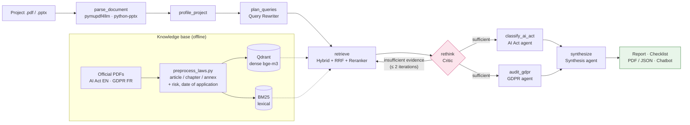

<div align="center">

# ⚖️ EU AI Compliance Auditor

**Local, privacy-by-design compliance audit of AI projects against the EU AI Act and the GDPR**

[](https://github.com/OWNER/eu-ai-compliance-auditor/actions/workflows/ci.yml)


-black)


</div>

> Replace `OWNER` in the CI badge URL with your GitHub user or organisation.

**EU AI Compliance Auditor** is a fully local multi-agent RAG application that audits an AI
project (PDF or PowerPoint) against the EU AI Act and the GDPR. It determines the project's
risk category, its applicable obligations and exact deadlines, and delivers a prioritised,
source-cited action plan. LLMs, embeddings and the vector database all run on your machine.

Upload a project presentation (`.pdf` or `.pptx`) and the application:

- identifies the **AI Act risk category**;
- lists the **applicable obligations and exact deadlines**, including the postponements
  introduced by Regulation (EU) **2026/1744 ("Digital Omnibus on AI")**;
- audits the processing of personal data under the **GDPR** (lawful basis, minimisation, DPIA,
  data subject rights);
- produces a **prioritised action plan**, an **interactive checklist** and a **PDF/JSON report**.

A contextual **chatbot** then helps the team improve the project.

Everything runs **locally**: LLM and embeddings through Ollama, the Qdrant vector database
and an ONNX reranker on CPU. No document ever leaves the machine, and the audited file is
deleted at the end of the analysis.

> ⚠️ Decision-support tool. It does not constitute legal advice.

---

## Contents

- [Architecture](#architecture)
- [Key features](#key-features)
- [Quick start (Docker)](#quick-start-docker)
- [Local installation (uv)](#local-installation-uv)
- [Configuration](#configuration)
- [Code quality](#code-quality)
- [Testing & evaluation](#testing--evaluation)
- [Repository layout](#repository-layout)
- [Known limitations](#known-limitations)

## Architecture



| Stage | Role | Guardrail |
|---|---|---|
| **Legal preprocessing** | Splits the texts by article and annex with a state machine that only accepts strictly sequential numbering. Long articles are sub-split on paragraph boundaries. | Integrity check: 113 articles + 13 annexes (AI Act), 99 articles (GDPR) |
| **Query Rewriter** | Generates targeted legal sub-questions, written in the language of each corpus | Deterministic anchor queries (Art. 5, Annex III, Art. 6, 22, 35, 50...) |
| **Hybrid retrieval** | Dense search (Qdrant, strict metadata filters) + BM25, fused with RRF, then reranked by FlashRank (multilingual ONNX) or `BAAI/bge-reranker-v2-m3` | Automatic fallback to the RRF order when the reranker is unavailable |
| **Rethinker** | An LLM critic checks whether the evidence is sufficient. If not, it reformulates the queries (≤ 2 loops). | A regulation with no evidence forces another iteration; the loop is bounded |
| **Audit agents** | AI Act classification and GDPR audit run **in parallel** (LangGraph fan-out/fan-in), with Pydantic structured outputs | Every citation is validated against the corpus; invented provisions are flagged |
| **Synthesis** | Executive summary + prioritised action plan (P0–P3) | **Deadlines, score and checklist are computed by code**, never by the LLM |

Every LLM call has a **deterministic fallback**. If the local model fails (invalid JSON after
self-correction, timeout), the audit still completes, with "to verify" statuses and warnings
in the report.

## Key features

- **Up-to-date regulatory calendar.** AI Act application dates follow Art. 113, as amended by
  Regulation (EU) 2026/1744 (in force since 27/07/2026):
  - Annex III high-risk systems: **02/12/2027**
  - Annex I high-risk products: **02/08/2028**
  - New prohibitions and end of the Art. 50(2) grace period: **02/12/2026**
- **Strict metadata on every chunk**: `source`, `article_number`, `annex_number`,
  `chapter_*`, `section_*`, `risk_category`, `enforcement_date`, `enforcement_note`, `topics`.
- **3-page Streamlit UI**:
  1. *Overview & Architecture*: diagram, interactive calendar (Plotly), health of Ollama,
     Qdrant and the reranker, and a pre-indexing button.
  2. *Audit & Chatbot*: upload, live progress of the LangGraph nodes, tabbed report, and a
     contextual chatbot that shows its sources and checks the provisions it cites.
  3. *Export*: detailed report, interactive checklist with progress, **PDF** (ReportLab) and
     **JSON** export (the JSON can be reloaded).
- **Security**:
  - uploaded files are checked by binary signature and size, then stored under random names;
  - the document is deleted after the audit;
  - ports are bound to `127.0.0.1`, the container runs as non-root, and the API key is a `SecretStr`.

## Quick start (Docker)

Requirements: Docker ≥ 24 with Compose v2, and about 16 GB of RAM for `qwen2.5:14b` (or a
smaller model, see [Configuration](#configuration)).

```bash
git clone https://github.com/OWNER/eu-ai-compliance-auditor.git
cd eu-ai-compliance-auditor
cp .env.example .env          # optional: choose the models

docker compose up -d --build  # NVIDIA GPU: add -f docker-compose.gpu.yml
docker compose logs -f ollama # first run: models are being pulled
```

Open **http://localhost:8501**. On startup:

1. the `ollama` container starts the server and pulls the models
   (`docker/ollama/entrypoint.sh`). It only becomes *healthy* once every model is ready.
2. the `app` container waits for Qdrant and Ollama, then indexes the legal corpus if the
   collection is empty (`AUTO_INDEX=true`).
3. a demo project is provided: `examples/demo_hirematch.pptx`.

## Local installation (uv)

```bash
# 1. Dependencies (dev + eval) and git hooks
make install                  # = uv sync --all-groups && uv run pre-commit install

# 2. Services: Ollama (https://ollama.com) and Qdrant
ollama pull qwen2.5:14b && ollama pull bge-m3
docker run -d -p 6333:6333 qdrant/qdrant:v1.15.4
#    ...or embedded Qdrant, without Docker: QDRANT_URL= QDRANT_PATH=./data/qdrant_local

# 3. Preprocess + index the legal corpus
uv run python -m src.rag.preprocess_laws --index --stats

# 4. UI
uv run streamlit run app.py
```

## Configuration

All settings come from environment variables or a `.env` file (see `.env.example`). They are
validated at startup by `pydantic-settings` (`src/core/config.py`).

| Variable | Default | Description |
|---|---|---|
| `OLLAMA_BASE_URL` | `http://localhost:11434` | Ollama server |
| `LLM_MODEL` | `qwen2.5:14b` | Agents' reasoning model (`mistral-nemo` is an alternative) |
| `JUDGE_MODEL` | `qwen2.5:14b` | Ragas judge |
| `EMBEDDING_MODEL` | `bge-m3` | Multilingual embeddings. `nomic-embed-text` is supported; its prefixes are added automatically. |
| `LLM_NUM_CTX` | `16384` | Context window sent to Ollama |
| `QDRANT_URL` / `QDRANT_PATH` | `http://localhost:6333` / – | Server or embedded mode (leave `QDRANT_URL` empty for embedded) |
| `RERANKER_BACKEND` | `flashrank` | `flashrank` · `cross_encoder` (requires the `bge-reranker` extra) · `none` |
| `RERANK_TOP_N` | `6` | Chunks kept per query |
| `MAX_RETHINK_ITERATIONS` | `2` | Maximum number of Rethinker loops |
| `RAGAS_MIN_*` | `0.70 / 0.60 / 0.60` | Quality gates (faithfulness / context / answer) |

On a modest machine, use `LLM_MODEL=qwen2.5:7b` and `LLM_NUM_CTX=8192`.

## Code quality

- **Pydantic v2 everywhere.**
  - All domain objects are Pydantic models with `extra="forbid"`: legal chunks, LLM
    structured outputs, the report and the LangGraph state.
  - They use constrained types: patterns for CELEX numbers, chunk ids and SHA-256;
    `ge`/`le` bounds for confidences and scores; non-empty strings.
  - Cross-field invariants are checked by `model_validator`.
- **Validated function inputs.**
  - Every public function that crosses a layer boundary (UI, CLI, LLM output, files) is
    decorated with `@validated`, a thin wrapper around `pydantic.validate_call`
    (`src/core/types.py`).
  - Invalid arguments fail fast with a `ValidationError`. Examples: an empty query, `top_k=0`,
    a missing file passed as a `FilePath`.
  - Internal hot paths (tokeniser, parser state machine) are deliberately left undecorated.
- **Typed services.**
  - Services are injected through validated containers (`AuditDependencies`, `HybridRetriever`).
  - Interfaces are `Protocol`s (`LLMService`, `Reranker`), which keeps the agents testable
    with fakes.
- **Explicit error model.** A domain exception hierarchy (`src/core/exceptions.py`) separates
  expected failures from bugs. Broad `except` blocks are lint-enforced (`BLE`) and always
  justified.
- **Tooling.**
  - Ruff: lint + format, with the bugbear, bandit, pylint and pyupgrade rule sets.
  - `mypy --strict` on the source *and* the tests.
  - pre-commit hooks, plus deterministic artefacts verified in CI.

## Testing & evaluation

```bash
make check                                   # ruff + mypy --strict + pytest (no external service)
uv run pytest tests/eval -m eval -v --no-cov # Ragas (requires Ollama + index)
uv run python -m src.evaluation.dataset --per-source 10   # synthetic test set
```

- **Unit & integration tests** run on the real corpus, with:
  - in-memory Qdrant and deterministic embeddings;
  - a scripted fake LLM that covers the Rethinker loop, parallel agents, degraded mode and
    hallucination detection;
  - a fake Ollama HTTP server that checks the JSON schema, self-correction and streaming;
  - `streamlit.testing` for the pages.

  CI also checks that `data/processed/legal_chunks.jsonl` regenerates byte-for-byte from the PDFs.
- **Ragas evaluation** (`tests/eval/test_ragas.py`):
  - the Ollama judge is plugged in through `LangchainLLMWrapper` / `LangchainEmbeddingsWrapper`;
  - metrics: `faithfulness`, `nv_context_relevance` and `answer_relevancy`;
  - two deterministic checks: the reference provision is retrieved, and no non-existent
    provision is cited;
  - test set: 14 curated *golden* questions verified against the texts, plus the synthetic
    set when it has been generated.
- **GitHub Actions CI**:
  - pipeline: ruff → mypy → pytest (Python 3.11 / 3.12 / 3.13) → Docker build → Ragas
    evaluation, with Ollama installed on the runner;
  - Ragas runs on `main`, weekly, on demand, or on PRs labelled `run-eval`;
  - the CPU runner uses smaller models (`qwen2.5:3b` / `7b`) with adjusted thresholds, and
    reports are uploaded as artefacts.

## Repository layout

```
├── app.py                       # Streamlit entry point (st.navigation)
├── pages/                       # presentation.py · audit.py · export.py
├── src/
│   ├── core/                    # config (pydantic-settings), types (@validated), exceptions, llm, logging
│   ├── models/schemas.py        # Pydantic models: corpus, LLM outputs, report, LangGraph state
│   ├── ingestion/parser.py      # PDF (pymupdf4llm) & PPTX (python-pptx) -> Markdown
│   ├── rag/
│   │   ├── preprocess_laws.py   # Structure-aware legal splitting + metadata (CLI)
│   │   ├── vector_store.py      # Qdrant: idempotent indexing, filters
│   │   └── retriever.py         # BM25, RRF, rerankers, hybrid retriever
│   ├── agents/
│   │   ├── graph.py             # LangGraph graph + ComplianceAuditor facade
│   │   ├── nodes.py             # Nodes: rewriter, retrieve, rethinker, agents, synthesis
│   │   ├── prompts.py           # System prompts
│   │   └── chat.py              # Chatbot / legal QA
│   ├── compliance/              # timeline (deadlines), obligations (checklist), citations, scoring
│   ├── evaluation/              # Synthetic test set + Ragas wiring
│   ├── export/pdf_generator.py  # PDF (ReportLab) & JSON report
│   └── ui/services.py           # Cached Streamlit resources, session state
├── data/
│   ├── regulations/             # Official PDFs: AI Act (EN) & GDPR (FR)
│   └── processed/legal_chunks.jsonl
├── tests/ unit/ · integration/ · eval/ (test_ragas.py, data/golden_testset.jsonl)
├── examples/demo_hirematch.pptx
├── Dockerfile · docker-compose.yml · docker-compose.gpu.yml · docker/
├── Makefile · .pre-commit-config.yaml
└── .github/workflows/ci.yml
```

## Known limitations

- The indexed AI Act text is the **original** version (OJ of 12/07/2024). The amendments of
  Regulation 2026/1744 are reflected in the dates and the calendar, not in the article text.
  Replace the PDF with a consolidated version to index them (see `data/regulations/README.md`).
- The GDPR corpus is the official **French** version, so GDPR retrieval queries are written in
  French. All analyses, reports and the UI are in English. Any other official language
  version can be used by adapting `GDPR_SPEC`.
- GDPR recitals and EDPB guidelines are not part of the corpus.
- Scanned documents require prior OCR.
- Analysis quality depends on the local model; `qwen2.5:14b` or larger is recommended in
  production.

## License

MIT. Legal texts: © European Union, EUR-Lex (reuse authorised, Decision 2011/833/EU).
